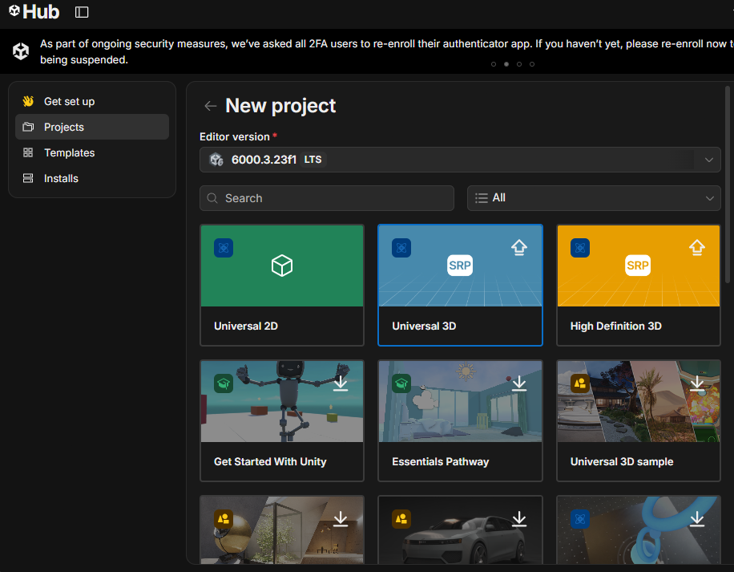
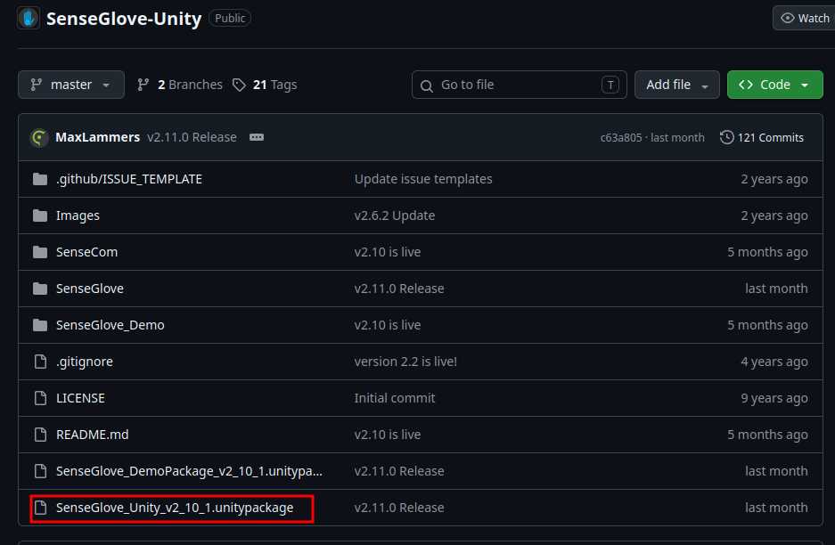
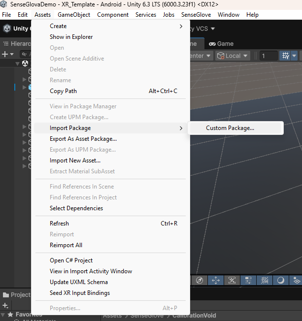
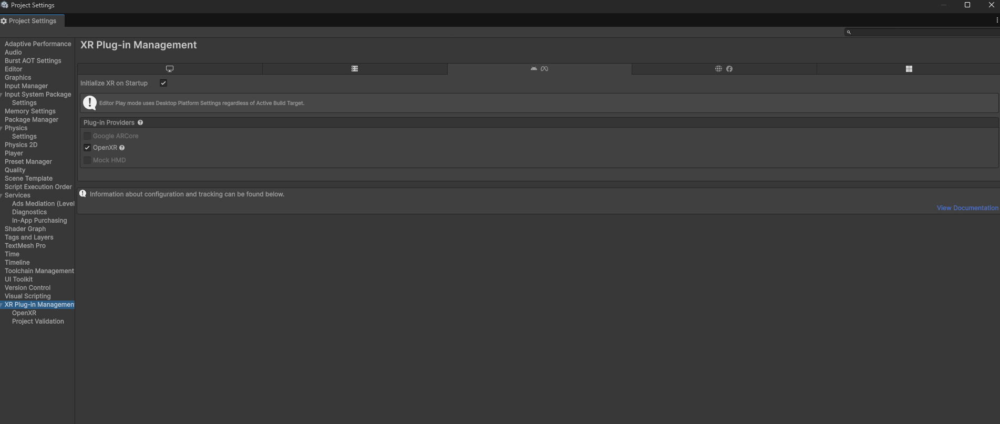
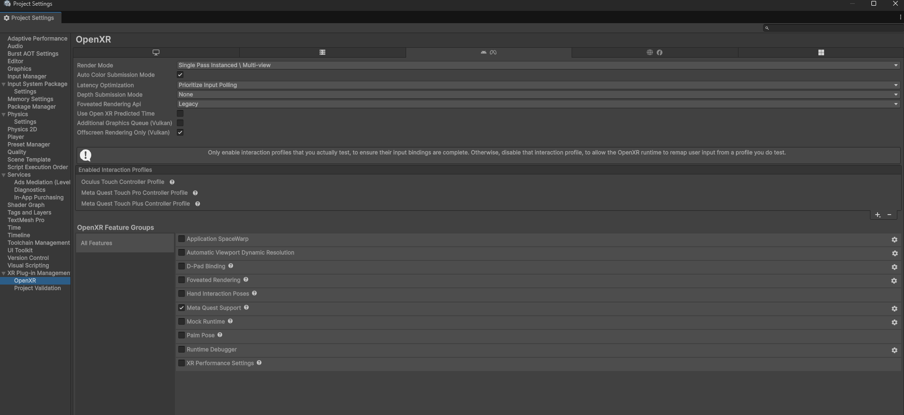
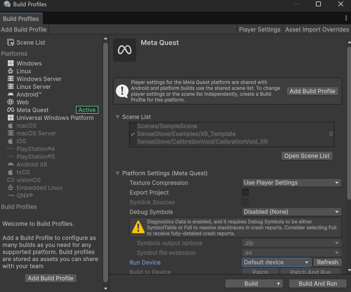

---
title: "Unity Setup for Meta Quest"
weight: 1
---

# SenseGlove on Meta Quest Pro with Unity
Tihis page will show you how to setup example project in unity and run demo application with SenseGlova Nova 2.0
__NOTE: you need developer account for meta quest__

### Unity setup
##### 1. Install unity
 - Install unity hub and Unity version 6000.3.x (Current latest LTS versoin)
 - Create a 3D project with Universal 3D template with LTS version of unity:

 

##### 2. Clone SenseGlove-Unity repo: https://github.com/Adjuvo/SenseGlove-Unity
 - In the root folder you will find 2 .unitypackage files, in this case we are interested with 'SenseGlove_Unity_vx_x_x.unitypakcage'

 

##### 3. Import unitypackage to unity project
 - Open newly created unity project and go to `Assets->Import Package->Custom` Package and in this case select `SenseGlove_Unity_v2_10_1.unitypackage`
 

##### 4. Enable OpenXR
 - Go to `Edit->Project Settings->XR Plug-in Maangement` and make sure OpenXR is selected under android/meta tab as Plugin-in Providers
 
 - Under `OpenXR` select related profile under `Enabled Interation Profiles` and make sure Meta Quest Support is selected under `OpenXR Feature Groups`
 
 - Make sure there are no errors under `Project Validation`

##### 5. Unity Project configuration
 - In project folders open `Assets->SenseGlove->Examples->XR_Template` in unity
 - Then go to `File->Build Profiles`
 - Set platform to `Meta Quest` and add `SenseGlove/Examples/XR_Template` to Scene List

 

After this you need to plug in meta quest, enble USB debugging and press `Build and Run`
This will upload apk file to your meta quest and run demo program.

